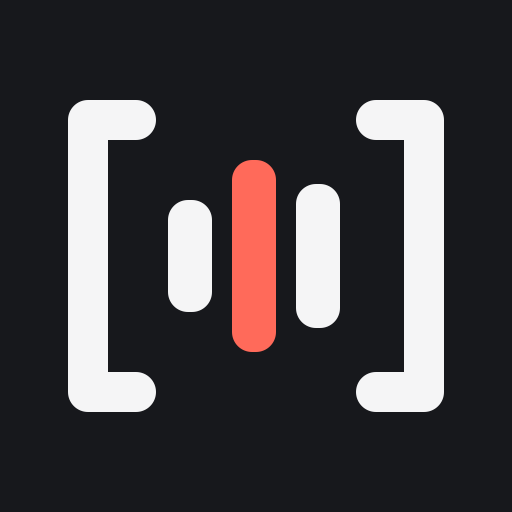
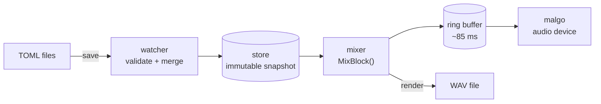

<p align="center">
  
</p>

<h1 align="center">CodaW</h1>

<p align="center"><strong>A code-first digital audio workstation.</strong><br/>Your whole song is plain-text TOML: edit a file, save, and hear the change.</p>

<p align="center">
  <a href="https://github.com/KevinGruber2001/codaw/actions/workflows/ci.yml"></a>
  <a href="https://github.com/KevinGruber2001/codaw/releases"></a>
  
</p>

---

Most DAWs keep your session in a binary file that only they can open. In CodaW the session is a
folder of small TOML files: one per track, one per bus, one for the master. You can diff it,
review it, branch it in git, generate it from a script or edit it by hand. Meanwhile the engine keeps
playing and picks up every save within a block.

The CodaW editor is a desktop and browser application built on Eclipse Theia. It gives you an
arrangement, a mixer, an inspector and a sample library on top of those same files. Everything you
do in the editor ends up as an edit to the TOML, so the files never stop being the source of truth.

## A taste

```toml
# tracks/pad.toml
id   = "pad"
bus  = "drums"
gain = -6.0
pan  = -0.1

[[fx]]
type      = "reverb"
room_size = 0.65
wet       = 0.4

[[clip]]
file  = "samples/pad_cmaj.wav"
start = 3.0      # beats
end   = 24.0
loop  = true

[[automation]]
target = "fx[0].wet"

[[automation.point]]
beat  = 0
value = 0.1

[[automation.point]]
beat  = 16
value = 0.6
```

Save it while the project plays, and the reverb opens up over 16 beats, with no restart and no click.

## Features

**Engine** ([`codaw/`](codaw/), Go)

- Projects split across files: tracks, buses, a master, clips, effects and automation
- One mixer for playback and rendering, so the export sounds exactly like what you heard
- Hot reload from a save to the next audio block; effect state carries across reloads, so a save
  never cuts a reverb tail or clicks a filter
- Effects written in Go: a 3-band EQ, a compressor, a Freeverb-style reverb and a master limiter,
  with every parameter smoothed
- Automation of track gain, pan and any effect parameter
- Non-destructive clip editing: trim, split and loop through `start`, `end`, `offset` and `loop`
- Validation that reports file and key, before anything plays
- Offline rendering to WAV, faster than real time
- A language server for the TOML files: diagnostics, completion and hover

**Editor** ([`editor/`](editor/), TypeScript, [Eclipse Theia](https://theia-ide.org))

- An arrangement with waveforms, automation lanes and a live playhead; drag, trim, copy, paste and
  delete clips
- A transport bar, a mixer with faders, pan knobs and mute/solo, and an inspector for the selected clip
- A sample library: preview samples, drop WAVs in to import them, and drag them onto a track to
  make a clip
- TOML editing with syntax highlighting and the engine's language server
- Auto-save: every change reaches the engine within half a second

## Getting started

You need [Go](https://go.dev) 1.25+, a C compiler (cgo, for the audio device) and
[Node.js](https://nodejs.org) 18+.

```bash
git clone https://github.com/KevinGruber2001/codaw.git
cd codaw/editor
npm install                 # installs and compiles every editor package
npm run build:engine        # builds the engine into ../codaw/bin
npm run build:browser
npm run start:browser       # then open http://localhost:3000
```

Open `codaw/testdata/basic` with **File → Open Folder**. The engine starts on its own, and the
status bar shows **Engine live**. Press <kbd>Space</kbd> to play.

For the desktop application, run `npm run build:electron && npm run start:electron`. The
[editor README](editor/README.md) covers packaging, development and the package layout.

### The engine on its own

The engine is a plain command-line program; the editor is optional.

```bash
cd codaw
go run ./cmd/codaw validate testdata/basic/project.toml          # check a project
go run ./cmd/codaw play     testdata/basic/project.toml          # play it (Ctrl-C to stop)
go run ./cmd/codaw watch    testdata/basic/project.toml          # play, and hot-reload as you edit
go run ./cmd/codaw render   testdata/basic/project.toml mix.wav  # bounce to a WAV
```

| Command | What it does |
|---|---|
| `validate` | Loads the project and every file it names, and reports what is wrong |
| `play` | Plays the project through the default output device |
| `watch` | Plays the project and hot-reloads it as files change |
| `render` | Renders the project to a 16-bit WAV, plus a 2-second tail for effects to ring out |
| `serve` | Runs under a frontend and speaks JSON lines over stdio (see [docs/ipc.md](docs/ipc.md)) |
| `lsp` | Runs the language server over stdio |
| `schema` | Prints, as JSON, what project files may contain |

Prebuilt engine binaries for macOS, Linux and Windows are attached to each
[release](https://github.com/KevinGruber2001/codaw/releases). `go install …@latest` is not supported,
because the Go module lives in the `codaw/` subdirectory.

## The project format

```
my-song/
├── project.toml        # name, tempo, sample rate, and which files make up the song
├── master.toml         # master gain, limiter, effects
├── buses/drums.toml    # a sub-mix that tracks can send to
├── tracks/kick.toml    # a track: level, routing, effects, clips, automation
└── samples/kick.wav
```

`project.toml` ties the project together:

```toml
[project]
name = "basic test"

[transport]
bpm         = 128.0
time_sig    = "4/4"
sample_rate = 48000
bit_depth   = 32

[layout]
master = "master.toml"
buses  = ["buses/drums.toml"]
tracks = ["tracks/kick.toml", "tracks/pad.toml"]
```

Positions are in beats, levels in dB and pan from -1 to 1. Effects run in the order they are
written, and automation addresses them by position, as `fx[0]`, `fx[1]`, and so on.

| Effect | Parameters |
|---|---|
| `eq_3band` | `low_hz`, `low_db`, `mid_hz`, `mid_db`, `high_hz`, `high_db` |
| `compressor` | `threshold`, `ratio`, `attack_ms`, `release_ms`, `makeup_db` |
| `reverb` | `room_size`, `wet` |

Setting `limiter = true` in `master.toml` keeps the output under -0.3 dBFS. Samples are WAV files,
16- or 24-bit, mono or stereo, at any sample rate (they are converted once, when loaded).

Every key, with its unit, range, default and documentation, is defined in a single place,
[`internal/schema`](codaw/internal/schema). Validation, the language server and the editor all read
it, and `codaw schema` prints it.

## How it works



- **Files are the only way project data moves.** The editor writes TOML, and the engine reads it.
  The `serve` channel carries only what you would never commit: play, stop, seek, the playhead
  position. [docs/ipc.md](docs/ipc.md) explains this split.
- **The mixer reads snapshots.** A save replaces the whole project in the store, and the mixer
  picks it up at the start of its next block. Nothing has to be told what changed, so a new
  parameter needs a struct field and nothing else.
- **One function is the signal path.** `MixBlock` mixes the clips into their track and applies the
  track's effects, gain and pan. The track goes into its bus or the master; each bus adds its
  effects and gain; the master applies its effects, gain and limiter. Playback and render both call
  it.
- **The audio thread only copies.** The mixer runs on an ordinary goroutine and fills a lock-free ring
  buffer that the device callback reads from. A garbage collection pause uses up some of the buffer's
  headroom rather than causing a dropout.

| Package | Role |
|---|---|
| `project` | Loads and validates the TOML |
| `schema` | What the files may contain |
| `state` | The current project, as an atomic pointer to an immutable snapshot |
| `watcher` | Turns saves into new snapshots |
| `sample` | Decodes WAVs into float32 buffers at the project's rate |
| `mix` | The mixer |
| `dsp` | The effects |
| `audio` | The device: a malgo player and its ring buffer |
| `engine` | Ties the mixer, the player and the store together |
| `serve`, `lsp` | What the editor talks to |

## Development

```bash
cd codaw && go test -race ./...     # engine
cd editor && npm run build:browser  # editor
```

CI runs the engine's build, vet and tests on Linux, macOS and Windows. Pushing a `v*` tag builds
release binaries for every platform.

## Status

CodaW is a personal project, built to learn audio programming in Go and Theia's extension model.
It plays, mixes, automates and renders real projects. Some things it does not do yet:

- Recording
- Per-track level meters in the mixer
- MIDI and instruments
- Audio formats other than WAV
- User plugins: [effects written in Lua](https://github.com/KevinGruber2001/codaw/issues/7) that live
  in the project folder, are being designed

## License

[MIT](LICENSE)
